<div align="center">

  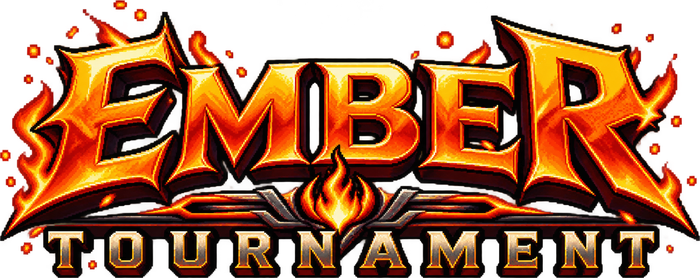

  <h3>A 1080p Pixel-Art Fighting Game in Python & Pygame-CE</h3>

  <p>
    <strong>Six legendary combatants. Three animated arenas. Cinematic supers and finishers.</strong>
  </p>

  <p>
    <a href="https://github.com/skrehanahamed/EmberTournament/releases"></a>
    <a href="https://github.com"></a>
    <a href="https://pyga.me"></a>
    <a href="https://github.com/skrehanahamed/EmberTournament/actions/workflows/windows-exe.yml"></a>
    
  </p>

  <p>
    <a href="#releases-and-downloads"><b>Download Releases (.exe)</b></a> •
    <a href="#game-screenshots"><b>Screenshots</b></a> •
    <a href="#fighter-roster"><b>Fighter Roster</b></a> •
    <a href="#game-modes"><b>Modes</b></a> •
    <a href="#controls-and-combos"><b>Controls</b></a> •
    <a href="#run-from-source-macos-linux-windows"><b>Run from Source</b></a> •
    <a href="#github-actions-automated-windows-exe-build"><b>CI/CD Build</b></a>
  </p>

</div>

---

## Releases and Downloads

Pre-compiled Windows binaries are automatically packaged and published via GitHub Actions. Python installation is not required.

* **Latest Release**: [Download Ember Tournament (Latest Build)](https://github.com/skrehanahamed/EmberTournament/releases/latest)
* **All Releases and Changelog**: [View All Releases](https://github.com/skrehanahamed/EmberTournament/releases)

### Available Packages

| Package | Description | Recommended For |
| :--- | :--- | :--- |
| **`EmberTournament-Windows-x64.zip`** | Full standalone package. Contains `EmberTournament.exe`, internal dependencies, stages, character art, and audio files. | **Recommended**: Extract and double-click `EmberTournament.exe` to play immediately. |
| **`EmberTournament.exe`** | Standalone executable binary with built-in asset recovery. | Direct executable file. If assets are not present in the local directory, it will prompt to automatically download them from GitHub on first launch. |

### System Requirements

| Specification | Minimum Requirement | Recommended |
| :--- | :--- | :--- |
| **Operating System** | Windows 10 (64-bit) | Windows 10 / Windows 11 (64-bit) |
| **Processor** | Intel Core i3 / AMD Ryzen 3 | Intel Core i5 / AMD Ryzen 5 |
| **Memory** | 4 GB RAM | 8 GB RAM |
| **Graphics** | DirectX 11 / OpenGL 3.3 compatible | Dedicated GPU or modern integrated graphics |
| **Storage** | 350 MB available space | 500 MB available space |
| **Audio** | Any DirectX-compatible sound output | Stereo speakers / headphones |
| **Input Devices** | Standard Keyboard | PS5 DualSense / Xbox Controller |

### How to Install and Play on Windows

1. Download **`EmberTournament-Windows-x64.zip`** from the [Latest Release](https://github.com/skrehanahamed/EmberTournament/releases/latest).
2. Right-click the `.zip` archive and select **Extract All...**.
3. Open the extracted folder and double-click **`EmberTournament.exe`** to start playing.
4. *(Optional)* Plug in a PlayStation or Xbox controller — it will be detected automatically with full button prompt mapping and rumble feedback.

> **Windows SmartScreen Note**: Because this is an indie open-source game without an expensive corporate signing certificate, Windows Defender SmartScreen may display a "Windows protected your PC" pop-up. Simply click **"More info"** and then **"Run anyway"**.

### Automatic Asset Recovery

If you ever move `EmberTournament.exe` to a new folder without its `data/` assets, or if any core files are missing, the built-in self-healing system will automatically detect the missing components, prompt for confirmation, and download them directly from GitHub Releases without requiring a full manual re-download.

You can also download build artifacts directly from the [Actions tab](https://github.com/skrehanahamed/EmberTournament/actions).

---

## Game Screenshots

<div align="center">
  <table border="0">
    <tr>
      <td width="50%">
        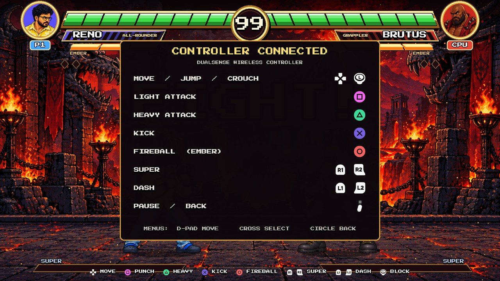
        <p align="center"><em>Reno vs Brutus — Volcanic Ruins</em></p>
      </td>
      <td width="50%">
        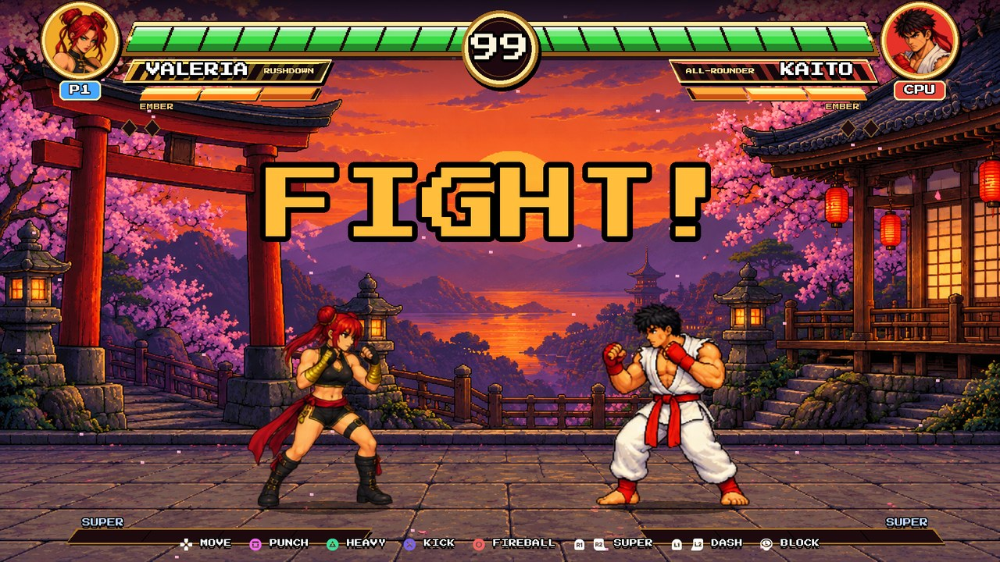
        <p align="center"><em>Valeria vs Kaito — Sunset Shrine</em></p>
      </td>
    </tr>
    <tr>
      <td width="50%">
        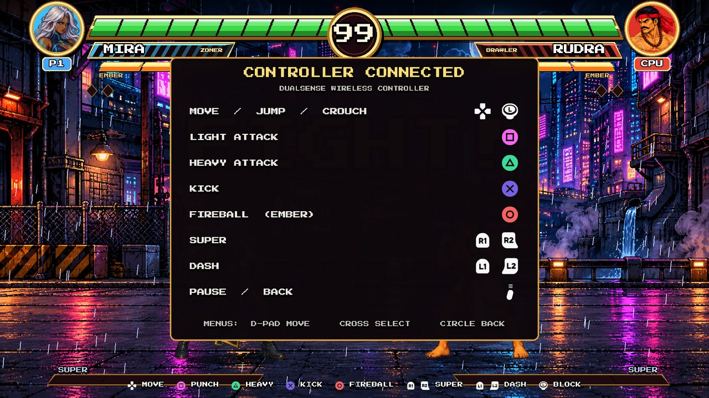
        <p align="center"><em>Mira vs Rudra — Neon City</em></p>
      </td>
      <td width="50%">
        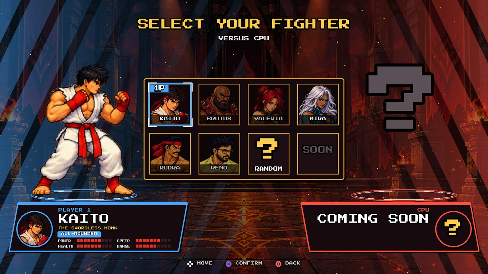
        <p align="center"><em>Character Selection and Fighter Archetypes</em></p>
      </td>
    </tr>
    <tr>
      <td width="50%">
        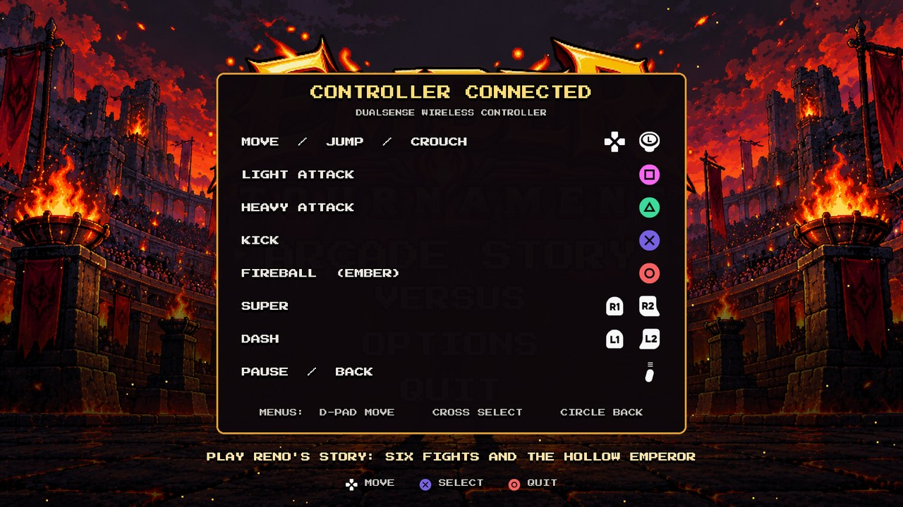
        <p align="center"><em>Title Screen and Ambient Embers</em></p>
      </td>
      <td width="50%">
        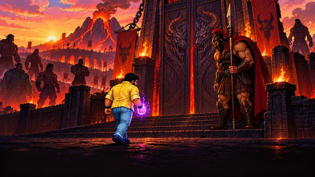
        <p align="center"><em>Arcade Story Mode Illustrated Cutscenes</em></p>
      </td>
    </tr>
  </table>
</div>

---

## Game Features

* **Authentic 2D Fighting Engine**: Fixed-timestep 60 FPS physics, block-stun, hit-stun, corner pushback, jump arcs, and attack priority.
* **Combo and Cancel System**: Cancel normal attacks into heavy strikes, kicks, and fireball specials on hit-confirm.
* **Cinematic Supers and Finishers**: Charge your Ember Meter through combat to trigger screen-shattering Super Moves and match-winning cinematic Finishers.
* **Full Controller Support**: Plug-and-play support for PlayStation DualSense (PS5), Xbox Wireless Controllers, and standard PC gamepads with vibration feedback and on-screen button prompts.
* **Hardware GPU Scaling**: Native 1920x1080 internal resolution smoothly presented in resizable windowed or borderless fullscreen modes.
* **Full Audio, Voice Acting and Win Quotes**: Custom sound effects, dynamic punch/kick impacts, stage music, voice-acted story narration, and character-specific victory quotes.
* **Victory Celebration Dances**: Unique animated post-match celebration dances for each combatant.

---

## Fighter Roster

Six unique martial artists with distinct archetypes, hitboxes, frame data, and special moves:

| Fighter | Archetype | Style and Lore | Super Move and Finisher |
| :---: | :---: | :--- | :--- |
|  <br/> **RENO** | **All-Rounder** | An ordinary brawler with an extraordinary temper. Signs every fireball and strike with a blazing neon "R". | **Super**: *R-Sign Blast*<br/>**Finisher**: *R-Sign Annihilation* |
| 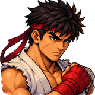 <br/> **KAITO** | **All-Rounder** | A young monk who lost his master and his sacred blade. Fights with disciplined dragon-flame fists. | **Super**: *Dragon Breath*<br/>**Finisher**: *Dragon Fist of Embers* |
| 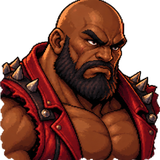 <br/> **BRUTUS** | **Grappler** | Exiled coliseum powerhouse with heavy armor and crushing high-damage strikes that dominate close range. | **Super**: *Magma Crush*<br/>**Finisher**: *Molten Hammer* |
| 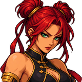 <br/> **VALERIA** | **Rushdown** | A desert assassin wielding crimson embers. Blistering walk speed and relentless offensive pressure. | **Super**: *Crimson Tempest*<br/>**Finisher**: *Crimson Desert Storm* |
| 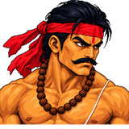 <br/> **RUDRA** | **Brawler** | Bengal's Iron Fist. A delta wrestler whose sacred flames empower devastating close-combat barrages. | **Super**: *Tiger Roar*<br/>**Finisher**: *Bengal Tiger Flame* |
| 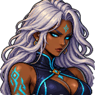 <br/> **MIRA** | **Zoner** | Storm mage controlling the battlefield from afar with high-velocity electric projectiles and long reach. | **Super**: *Storm Caller*<br/>**Finisher**: *Thunder Judgement* |
| 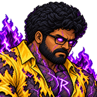 <br/> **HOLLOW EMPEROR** | **Final Boss** | A dark, burning manifestation of pure void flame. Massive health bar, devastating combos, and terrifying screen control. | **Super**: *Void R-Sign*<br/>**Finisher**: *Hollow Eclipse* |

---

## Stages

| Neon City | Sunset Shrine | Volcanic Ruins |
| :---: | :---: | :---: |
| 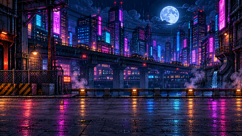 | 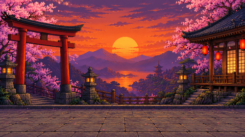 | 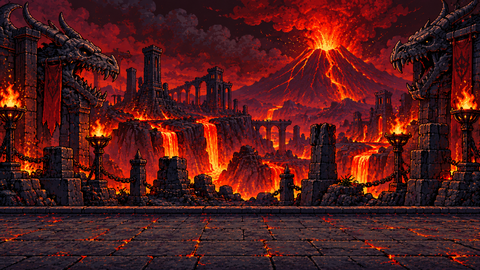 |
| Cyberpunk metropolis drenched in torrential rain | Sacred mountain temple with drifting cherry petals | Molten arena surrounded by rising sparks and ash |

---

## Game Modes

* **Arcade Story Mode**: Embark on a 7-chapter narrative journey as Reno. Battle through the tournament ranks, uncover the secret of the Dragon Cores, and defeat the Hollow Emperor in a climactic showdown. Features voiced dialogue and chapter art.
* **Boss Encounter (`make dev-boss` or `--boss`)**: Jump directly into a final battle against The Hollow Emperor.
* **Versus CPU**: Test your skills against computer-controlled opponents across three selectable difficulty levels (*Easy*, *Normal*, *Hard*).
* **Versus 2-Player (Local)**: Challenge a friend locally on a shared keyboard or dual controllers.
* **CPU vs CPU**: Watch AI combatants battle it out in demonstration mode.
* **Developer Mode (`make dev`)**: Real-time hitboxes, frame data counters, hurtbox debugging, and quick-swap fight triggers.

---

## Controls and Combos

### Keyboard Controls

| Action | Player 1 | Player 2 |
| :--- | :---: | :---: |
| **Move Left / Right** | <kbd>A</kbd> / <kbd>D</kbd> | <kbd>Left</kbd> / <kbd>Right</kbd> |
| **Jump / Crouch** | <kbd>W</kbd> / <kbd>S</kbd> | <kbd>Up</kbd> / <kbd>Down</kbd> |
| **Block** | Hold away from opponent | Hold away from opponent |
| **Light Punch** | <kbd>F</kbd> | <kbd>J</kbd> |
| **Heavy Punch** | <kbd>G</kbd> | <kbd>K</kbd> |
| **Kick** | <kbd>H</kbd> | <kbd>L</kbd> |
| **Fireball (Special)** | <kbd>T</kbd> | <kbd>I</kbd> |
| **Super Move** | <kbd>Y</kbd> | <kbd>O</kbd> |
| **Pause / Back** | <kbd>Esc</kbd> | <kbd>Esc</kbd> |
| **Fullscreen** | <kbd>F11</kbd> | <kbd>F11</kbd> |
| **Toggle CPU / Player 2** | <kbd>F1</kbd> | <kbd>F1</kbd> |

### Game Controller (PS5 DualSense / Xbox / Standard Gamepads)

Gamepads are automatically recognized upon plugging in or pairing over Bluetooth:

| Button (PlayStation) | Button (Xbox) | Action |
| :--- | :--- | :--- |
| **D-Pad / Left Stick** | **D-Pad / Left Stick** | Move, Jump, Crouch (Double-tap left/right to Dash) |
| **Square** | **X** | Light Attack |
| **Triangle** | **Y** | Heavy Attack |
| **Cross** | **A** | Kick |
| **Circle** | **B** | Fireball Special (Ember) |
| **R1 / R2** | **RB / RT** | Super Move |
| **L1 / L2** | **LB / LT** | Quick Dash |
| **Options / Start** | **Menu / Start** | Pause Match / Menu Back |

### Special Moves and Combo Execution

* **Quarter-Circle Fireball**: Tap <kbd>Down</kbd>, <kbd>Down+Forward</kbd>, <kbd>Forward</kbd> + <kbd>Punch</kbd> (or hit your assigned Special button).
* **Hit Cancels**: Connect with a **Light Attack**, then immediately input **Heavy**, **Kick**, or **Fireball** to cancel recovery frames into a fluid combo sequence.
* **Super Move**: When the bottom Ember meter is fully charged, activate your Super to execute an unblockable multi-hit surge.

---

## Run from Source (macOS, Linux, Windows)

### Prerequisites

* Python **3.10** or higher
* `pip` package manager

### 1. Clone the Repository

```bash
git clone https://github.com/skrehanahamed/EmberTournament.git
cd EmberTournament
```

### 2. Set Up Virtual Environment

On **macOS / Linux**:
```bash
make setup
make run
```

Or manually:
```bash
python3 -m venv .venv
source .venv/bin/activate
pip install -r requirements.txt
python main.py
```

On **Windows**:
Double-click `run_windows.bat` or run:
```bat
python -m venv .venv
.venv\Scripts\activate
pip install -r requirements.txt
python main.py
```

### Command Line Options

```bash
python main.py --help
  --demo                 # Launch directly into CPU vs CPU demonstration
  --screen fight         # Jump straight into battle
  --p1 reno --p2 brutus  # Choose starting fighters
  --stage volcano        # Choose stage: neon, temple, volcano
  --dev                  # Enable developer hotkeys and hitbox overlay
  --fullscreen           # Launch directly in fullscreen mode
```

---

## GitHub Actions: Automated Windows EXE Build

This repository includes continuous integration in [`.github/workflows/windows-exe.yml`](.github/workflows/windows-exe.yml).

### How It Works:
1. **Automated Triggers**: Runs automatically on pushes to `main` or `master`, on pull requests, or when a release tag (`v*`) is created.
2. **Manual Trigger (`workflow_dispatch`)**: Trigger a new Windows build at any time via **GitHub Actions** -> **Build Windows EXE** -> **Run workflow**.
3. **Artifact and Release Packaging**: The runner installs dependencies on `windows-latest`, compiles a self-contained executable with PyInstaller embedding the application icon and data assets, and creates:
   - `EmberTournament.exe`
   - `EmberTournament-Windows-x64.zip`
4. **Automated Releases**: The workflow publishes both files directly to [GitHub Releases](https://github.com/skrehanahamed/EmberTournament/releases) on every build of `main` and on version tags.

### Building Locally on Windows

If you are on a Windows machine and want to create the `.exe` locally:
```cmd
build_windows.bat
```
The compiled game will be generated in `dist\EmberTournament\EmberTournament.exe`.

---

## Project Structure

```
├── .github/workflows/
│   └── windows-exe.yml     # Automated GitHub Actions workflow for Windows EXE
├── docs/images/            # High-resolution screenshots, portraits, stages, and logo
├── ember/                  # Core game engine and state modules
│   ├── app.py              # Main application loop, display and scaling
│   ├── assets.py           # Frame slicing, animation loader, font caching
│   ├── audio.py            # Sound manager, BGM streaming, SFX pooling
│   ├── constants.py        # Physics constants, palettes, character stats
│   ├── fighter.py          # State machine, collision boxes, combos, supers
│   ├── gamepad.py          # SDL controller abstraction, haptics and rumble
│   ├── hud.py              # Health gauges, timer, combo counter, supers
│   ├── input.py            # Input buffering, keyboard and AI controllers
│   ├── screens.py          # Title, Character Select, Fight, and Results scenes
│   ├── settings.py         # Persistent configuration (~/.ember_tournament)
│   └── story.py            # Arcade story runner and narrative cutscenes
├── data/                   # Bundled production game assets (audio, sprites, fonts)
├── Assets/                 # Raw sprite sheets and master audio sources
├── tools/                  # Asset pipeline tools (sprite slicers, voice tools)
├── icon.ico                # Official Windows application icon
├── build_windows.bat       # Local one-click Windows compiler script
├── run_windows.bat         # One-click Windows game runner
├── Makefile                # Cross-platform development commands
├── requirements.txt        # Runtime dependencies (pygame-ce)
└── main.py                 # Game entry point
```

---

## Credits and License

* **Engine**: Built with [pygame-ce](https://pyga.me/) (Community Edition).
* **Font**: *Press Start 2P* by CodeMan38 (SIL Open Font License).
* **Gamepad Icons**: Kenney *Input Prompts* (CC0 Public Domain).
* **Audio and Music**: CC0 Public Domain compositions by Kenney, Pompei2, Tozan, and CleytonRX (see `Assets/audio_src/CREDITS.md`).
* **Game Code**: Open source under the [MIT License](LICENSE).
